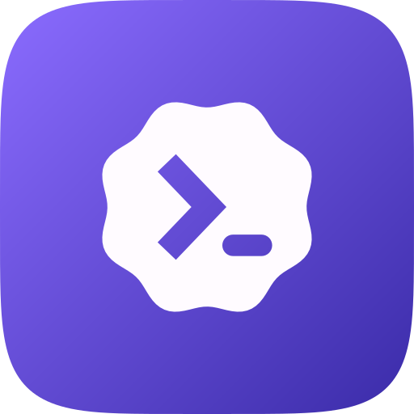

  
  <h1>AndroCode</h1>
  
<b>Автономный ИИ-агент для Android с Root-правами, лёгким русским TTS, .plugin и Dynamic Color</b>

  
  
  

---

### Возможности
- **Пошаговая первоначальная настройка**: Автогенерация случайного английского ника, аватары, выбор русского голоса и провайдера.
- **Лёгкий русский TTS и голосовой звонок**: Мгновенное офлайн-озвучивание ответов (Piper RU / Silero v4 / RHVoice / системный TTS) без облачных задержек.
- **Любые API-провайдеры и Custom Base URL**: Работа с Gemini, прокси-доменами (Base URL + API Key) и локальными `.gguf` моделями.
- **Root-доступ (`libsu`)**: Создание папок, управление сетью и запуск системных команд через Magisk / KernelSU / APatch.
- **Система плагинов (`.plugin`)**: Импорт пользовательских расширений и генератор промптов.
- **Мультимодальность**: Отправка фото, голосовые сообщения, генерация изображений со скачиванием и копированием в буфер обмена.
