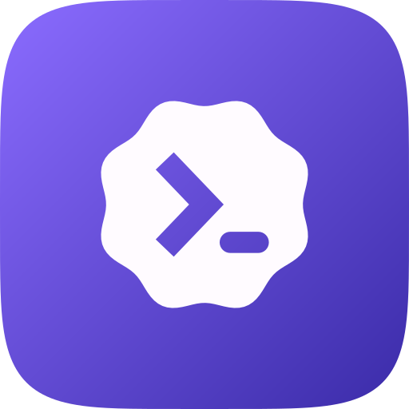
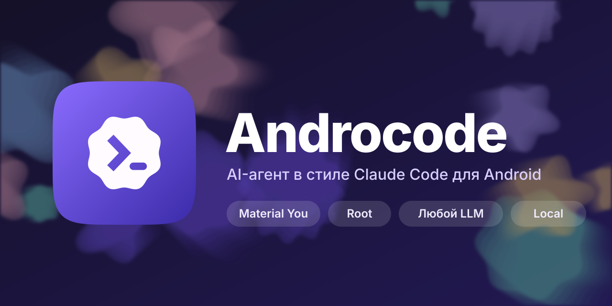
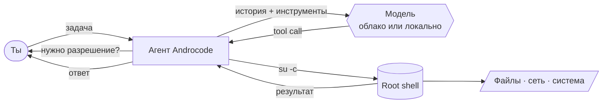

<div align="center">



# Androcode

**Claude Code-style AI agent for rooted Android.**<br/>
ИИ-агент в стиле Claude Code — прямо на твоём телефоне..

[](https://github.com/weqkj/androcode/actions)
[](https://github.com/weqkj/androcode/releases/latest)




</div>

---

## Что это

**Androcode** — Android-приложение, которое делает с телефоном то же, что Claude Code делает с ноутбуком: ты пишешь задачу обычным языком, а агент сам решает, какие команды выполнить, запускает их, смотрит на результат и продолжает, пока задача не будет решена.

Агенту нужен **root**: так он может создавать папки где угодно, видеть и менять систему, пользоваться сетью без ограничений песочницы приложения. Без root Androcode тоже запускается, но работает только внутри своей песочницы.

> «Кофе и Androcode ночью? Что делаем в раннюю ночь?» — при запуске приветствие подстраивается под время суток.

## Возможности

| | |
|---|---|
| 🤖 **Агентный цикл** | модель → вызов инструмента → результат → модель … до готового ответа (до 30 шагов за запрос) |
| 🛡️ **Root через `libsu`** | Magisk, KernelSU, APatch. Рабочая папка сохраняется между командами (`cd` работает) |
| ✋ **Подтверждение действий** | `bash` и запись файлов требуют разрешения — кнопки «Разрешить / Отклонить». Автоподтверждение — опционально |
| 🔑 **Любой провайдер** | Anthropic, OpenAI, OpenRouter, Gemini, свой домен/прокси (Base URL + ключ) |
| 📦 **Локальная модель** | скачай `.gguf` прямо в приложении и запусти `llama-server` через root |
| 🎨 **Material You (M3)** | динамические цвета из обоев *или* свой акцент (8 пресетов + ползунок оттенка), светлая/тёмная/AMOLED |
| 🌀 **Motion blur как в After Effects** | направленное размытие при переходах и субкадровые «шлейфы» у фигур — сила настраивается |
| 🫧 **Много фигур** | дрейфующие и морфящиеся «cookie / flower / burst / clover…» на фоне каждого экрана |
| 👋 **Онбординг и дисклеймер** | приветствие, понятный дисклеймер с обязательным подтверждением, ник, root, провайдер |
| 🎭 **Иконка, которую можно перекрасить** | adaptive + *themed icon* (Android 13+) и 7 цветов иконки на выбор в настройках |
| 🔐 **Ключи зашифрованы** | AES-GCM, ключ хранится в Android Keystore |

## Как это работает



### Инструменты агента

| Инструмент | Что делает | Разрешение |
|---|---|---|
| `bash` | Команда оболочки (mksh + toybox) от root; таймаут, сохранение `cwd` | спрашивает |
| `write_file` | Создать / перезаписать / дописать файл, папки создаются сами | спрашивает |
| `read_file` | Прочитать файл (с offset/limit) | автоматически |
| `list_dir` | `ls -la` | автоматически |
| `web_fetch` | HTTP GET с телефона, HTML → текст | автоматически |

## Установка

1. Открой **[Releases](https://github.com/weqkj/androcode/releases/latest)** и скачай `Androcode.apk`
   (или возьми свежую сборку из вкладки **Actions → Artifacts**).
2. Разреши установку из неизвестных источников и установи.
3. Нужен **Android 12+** (API 31) и, для полной силы, root (Magisk / KernelSU / APatch).

## Быстрый старт

1. Пройди приветствие → прими дисклеймер → выбери ник.
2. Нажми **«Запросить root»** — менеджер root покажет окно.
3. Вставь ключ провайдера (или выбери **Local** и скачай модель в *Настройки → Локальная модель*).
4. Напиши задачу, например: *«Создай папку /sdcard/Projects/demo и положи туда README»* — и подтверди команды.

### Провайдеры

| Провайдер | Base URL по умолчанию | Протокол |
|---|---|---|
| Anthropic | `https://api.anthropic.com/v1` | Messages API |
| OpenAI | `https://api.openai.com/v1` | Chat Completions |
| OpenRouter | `https://openrouter.ai/api/v1` | Chat Completions |
| Gemini | `https://generativelanguage.googleapis.com/v1beta/openai` | OpenAI-совместимый |
| Local | `http://127.0.0.1:8080/v1` | OpenAI-совместимый |
| Custom (OpenAI / Anthropic) | твой домен | выбираешь протокол |

Модель и Base URL можно менять — у каждого провайдера они запоминаются отдельно.

### Локальная модель

1. *Настройки → Локальная модель* → вставь ссылку на `.gguf` (например, с Hugging Face) → **Скачать**.
2. Нужен бинарник **`llama-server`**. Проще всего через Termux: `pkg install llama-cpp`.
3. Выбери скачанную модель, нажми **Запустить** (сервер стартует через root), затем **Проверить**.
4. Выбери провайдера **Local**. Для работы с инструментами нужна модель с поддержкой tool calling.

## Сборка из исходников

```bash
git clone https://github.com/weqkj/androcode
cd androcode
./gradlew assembleRelease
# → app/build/outputs/apk/release/app-release.apk
```

Нужны JDK 17 и Android SDK 34. Стек: Kotlin 1.9, Jetpack Compose, Material 3, [libsu](https://github.com/topjohnwu/libsu). CI собирает APK на каждый пуш; тег `v*` публикует релиз.

## Безопасность и дисклеймер

- **Root — это полный контроль.** Агент может удалить данные, изменить систему и сломать загрузку. Читай команды перед подтверждением, делай бэкапы.
- Диалог и вывод команд отправляются выбранному провайдеру. Локальная модель держит всё на устройстве.
- Ключ API хранится зашифрованным и уходит только твоему провайдеру.
- ПО предоставляется **«как есть», без гарантий**. Ответы ИИ бывают неверными.
- Независимый проект, **не связан с Anthropic**. «Claude Code» упомянут только как ориентир по идее.

## Статус

Ранняя версия 1.1. Ответы приходят целиком (без потокового вывода), история чата не сохраняется между перезапусками. Идеи на будущее: стриминг, сохранение сессий, Markdown-рендер, голосовой ввод.

## Лицензия

[MIT](LICENSE)

---

<div align="center">

**English summary** — Androcode is a Claude Code-style autonomous agent for rooted Android: root shell via libsu, bring-your-own provider key (Anthropic / OpenAI / OpenRouter / Gemini / custom) or a local GGUF model, Material You 3 UI with dynamic colour, AE-style motion blur, themed + recolourable launcher icon. Grab the APK from [Releases](https://github.com/weqkj/androcode/releases/latest). Not affiliated with Anthropic; use at your own risk.

</div>
